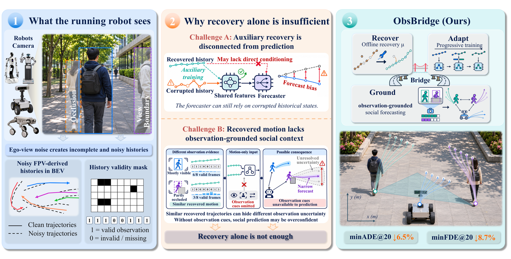
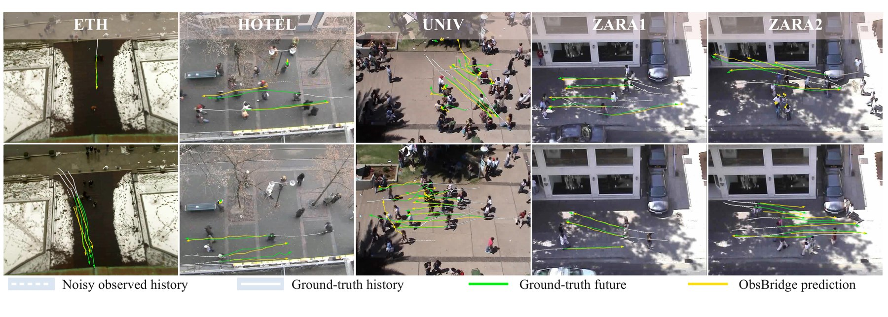
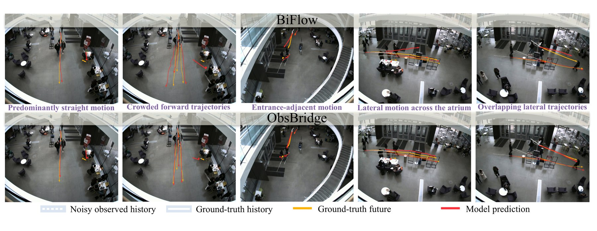
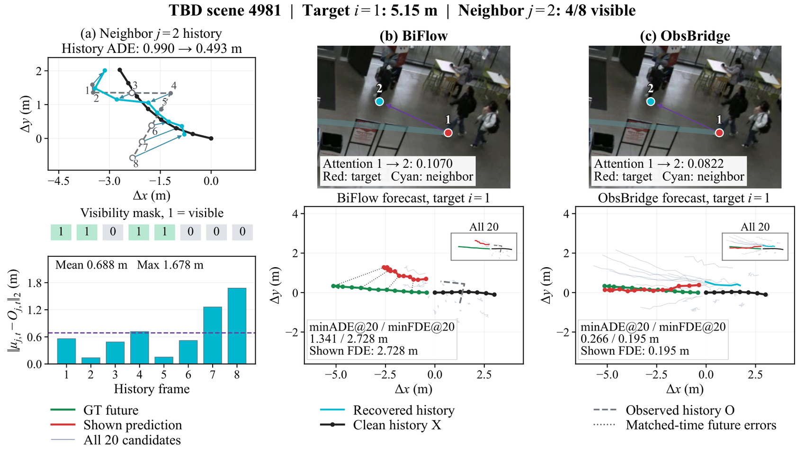

<br>
<div align="center">
<h1 align="center"><strong>ObsBridge: Observation-Grounded Conditioning for Ego Trajectory Prediction</strong></h1>
</div>

<div id="top" align="center">

[](https://arxiv.org/abs/2611.32447)     [](https://arxiv.org/pdf/2611.32447)     []()

</div>


 **Under review.** The full code will be released in this repository once the paper is accepted.


<sub>Ego-view noise corrupts BEV histories — recovery alone is insufficient.</sub>

## Overview

Pedestrian forecasting from ego-view observations is hard: occlusion, field-of-view truncation and tracking errors
corrupt the observed histories, and existing methods either impute coordinates before prediction or train an auxiliary
reconstruction branch that never conditions the forecaster.

**ObsBridge** instead treats the recovered history as a useful but imperfect condition — a frozen estimator recovers
it, an agent-wise curriculum adapts the predictor to residual recovery errors, and a residual geometry adapter plus
social attention expose raw observation evidence (visibility, viewing geometry, correction magnitude) to the
flow-based generator.


## Results

minADE@20 / minFDE@20 (m, lower is better); EgoTraj-TBD and the five T2FPV-ETH splits. BiFlow is our retrained baseline
evaluated with the identical test-time sampler.

| Method | EgoTraj-TBD | ETH | HOTEL | ZARA1 | ZARA2 | UNIV | AVG |
|:--|:--:|:--:|:--:|:--:|:--:|:--:|:--:|
| SGNet [38] | 0.40 / 0.59 | 1.43 / 1.97 | 0.72 / 1.00 | 0.58 / 0.79 | 0.78 / 0.91 | 1.48 / 1.73 | 1.00 / 1.28 |
| TUTR\* [36] | 0.37 / 0.59 | 1.25 / 1.54 | 1.04 / 1.47 | 0.77 / 1.00 | 0.75 / 0.91 | 1.10 / 1.30 | 0.98 / 1.24 |
| MoFlow [15] | 0.32 / 0.45 | 0.85 / 1.22 | 0.63 / 0.89 | 0.46 / 0.63 | 0.50 / 0.60 | 0.92 / 1.10 | 0.67 / 0.89 |
| Resonance [41] | 0.38 / 0.56 | 0.88 / 1.19 | 0.57 / 0.78 | 0.50 / 0.70 | 0.64 / 0.83 | 1.41 / 1.96 | 0.80 / 1.09 |
| Social-Mamba [27] | 0.32 / 0.48 | 0.96 / 1.34 | 0.60 / 0.82 | 0.49 / 0.66 | 0.53 / 0.64 | 0.99 / 1.18 | 0.71 / 0.93 |
| DD-MDN [19] | 0.35 / 0.53 | 1.17 / 1.68 | 0.39 / 0.47 | 0.49 / 0.71 | 0.56 / 0.70 | 0.97 / 1.16 | 0.72 / 0.94 |
| BiFlow [26] | 0.31 / 0.46 | 0.74 / 1.07 | 0.59 / 0.73 | 0.43 / 0.58 | 0.51 / 0.61 | 0.92 / 1.10 | 0.64 / 0.82 |
| **ObsBridge (ours)** | **0.29 / 0.42** | **0.70 / 1.01** | **0.50 / 0.60** | **0.41 / 0.54** | **0.50 / 0.60** | **0.89 / 1.07** | **0.60 / 0.76** |

<sub>Full table with all 16 baselines and the @1/@5/@20 breakdown is in the paper (Tables 1–2).</sub>

Ablation on EgoTraj-TBD (R = recovered-history conditioning, C = curriculum, A = social attention, G = geometry adapter):

| Model | R | C | A | G | @1 | @20 |
|:--|:--:|:--:|:--:|:--:|:--:|:--:|
| BiFlow | ✗ | ✗ | ✗ | ✗ | 0.977 / 1.691 | 0.307 / 0.458 |
| + history | ✓ | ✗ | ✗ | ✗ | 0.944 / 1.616 | 0.310 / 0.457 |
| + curriculum | ✓ | ✓ | ✗ | ✗ | 0.967 / 1.657 | 0.307 / 0.449 |
| + social attention | ✓ | ✓ | ✓ | ✗ | 0.923 / 1.593 | 0.307 / 0.448 |
| **ObsBridge** | ✓ | ✓ | ✓ | ✓ | **0.866 / 1.470** | **0.289 / 0.416** |

**Takeaways:** lower errors on all six test sets at both @1 and @20 (EgoTraj-TBD −6.5% / −8.7%, T2FPV-ETH AVG
−6.3% / −7.3%); the top-ranked forecast improves even more (@1 −11.2% / −13.0% on EgoTraj-TBD, −27.1% ADE@1 on HOTEL);
gains grow with the number of agents.

## Qualitative results


<sub>Predictions on the five T2FPV-ETH splits.</sub>


<sub>BiFlow (top) vs. ObsBridge (bottom) on EgoTraj-TBD.</sub>

**Case studies** — neighbor history recovery and the resulting forecasts (supplementary Figs. S1–S2):


<sub>Scene 1733, neighbor 6/8 visible: history ADE 0.896 → 0.408 m; minADE@20 0.960 → 0.405 m, shown FDE 1.684 → 0.665 m.</sub>


<sub>Scene 4981, neighbor 4/8 visible: history ADE 0.990 → 0.493 m; minADE@20 1.341 → 0.266 m, shown FDE 2.728 → 0.195 m.</sub>

## Citation

```bibtex
@article{wang2026obsbridge,
  title         = {ObsBridge: Observation-Grounded Conditioning for Ego Trajectory Prediction},
  author        = {Wang, Zhenhao and Liang, Shaofeng and Wu, Jiemin and Chen, Sijia and Shi, Keni
                   and Li, Nan and Chen, Wenshuo and Tian, Bowen and Guan, Runwei and Yue, Yutao},
  journal       = {arXiv preprint arXiv:2611.32447},
  year          = {2026},
  eprint        = {2611.32447},
  archivePrefix = {arXiv},
  primaryClass  = {cs.CV},
  doi           = {10.48550/arXiv.2611.32447}
}
```

## Acknowledgements

Built on [EgoTraj-Bench / BiFlow](https://github.com/zoeyliu1999/EgoTraj-Bench) and [T2FPV](https://github.com/benstoler/t2fpv).

<p align="right"><a href="#top">⬆ back to top</a></p>
