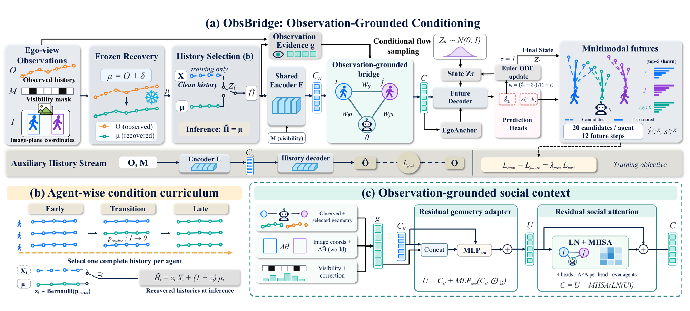
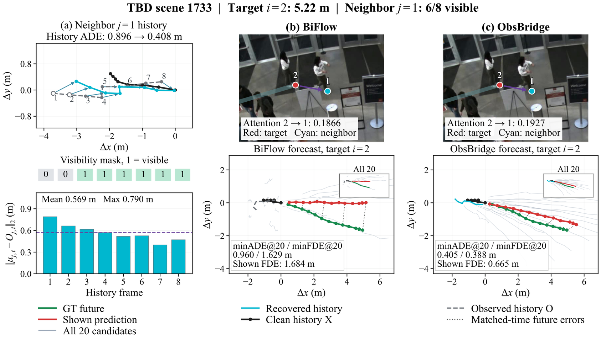

<br>
<div align="center">
<h1 align="center"><strong>ObsBridge: Observation-Grounded Conditioning for Ego Trajectory Prediction</strong></h1>
<p>
  Zhenhao Wang<sup>*,1</sup>&emsp;
  Shaofeng Liang<sup>*,&Dagger;,1,2</sup>&emsp;
  Jiemin Wu<sup>*,1</sup>&emsp;
  Sijia Chen<sup>3</sup>&emsp;
  Keni Shi<sup>1</sup>&emsp;
  Nan Li<sup>1</sup><br>
  Wenshuo Chen<sup>1</sup>&emsp;
  Bowen Tian<sup>1,2</sup>&emsp;
  Runwei Guan<sup>1</sup>&emsp;
  Yutao Yue<sup>1,4,&dagger;</sup>
</p>
<p>
  <sup>1</sup>HKUST (Guangzhou)&emsp;
  <sup>2</sup>EigenAct Technology&emsp;
  <sup>3</sup>Huazhong University of Science and Technology&emsp;
  <sup>4</sup>JITRI
</p>
<p>
  <sup>*</sup>Equal contribution&emsp;<sup>&Dagger;</sup>Project lead&emsp;<sup>&dagger;</sup>Corresponding author
</p>
</div>

<div id="top" align="center">

[](https://arxiv.org/abs/2611.32447)
[](https://arxiv.org/pdf/2611.32447)
[]()
[]()

</div>

> 📄 Paper: [arXiv:2611.32447](https://arxiv.org/abs/2611.32447)

> [!NOTE]
> **Under review.** The full code will be released in this repository once the paper is accepted.

<p align="center"></p>
<p align="center"><sub>Ego-view noise corrupts BEV histories — recovery alone is insufficient.</sub></p>

## Overview

Pedestrian forecasting from ego-view observations is hard: occlusion, field-of-view truncation and tracking errors
corrupt the observed histories, and existing methods either impute coordinates before prediction or train an auxiliary
reconstruction branch that never conditions the forecaster.

**ObsBridge** instead treats the recovered history as a useful but imperfect condition — a frozen estimator recovers
it, an agent-wise curriculum adapts the predictor to residual recovery errors, and a residual geometry adapter plus
social attention expose raw observation evidence (visibility, viewing geometry, correction magnitude) to the
flow-based generator.

<p align="center"></p>

## Results

minADE@20 / minFDE@20 (m, lower is better); EgoTraj-TBD and the five T2FPV-ETH splits. BiFlow is our retrained baseline
evaluated with the identical test-time sampler.

<table width="100%">
<thead>
<tr>
<th align="center" width="240">Method</th>
<th align="center" width="192">EgoTraj-TBD</th>
<th align="center" width="120">ETH</th>
<th align="center" width="120">HOTEL</th>
<th align="center" width="120">ZARA1</th>
<th align="center" width="120">ZARA2</th>
<th align="center" width="120">UNIV</th>
<th align="center" width="120">AVG</th>
</tr>
</thead>
<tbody>
<tr>
<td align="center">SGNet [38]</td>
<td align="center">0.40 / 0.59</td>
<td align="center">1.43 / 1.97</td>
<td align="center">0.72 / 1.00</td>
<td align="center">0.58 / 0.79</td>
<td align="center">0.78 / 0.91</td>
<td align="center">1.48 / 1.73</td>
<td align="center">1.00 / 1.28</td>
</tr>
<tr>
<td align="center">TUTR* [36]</td>
<td align="center">0.37 / 0.59</td>
<td align="center">1.25 / 1.54</td>
<td align="center">1.04 / 1.47</td>
<td align="center">0.77 / 1.00</td>
<td align="center">0.75 / 0.91</td>
<td align="center">1.10 / 1.30</td>
<td align="center">0.98 / 1.24</td>
</tr>
<tr>
<td align="center">MoFlow [15]</td>
<td align="center">0.32 / 0.45</td>
<td align="center">0.85 / 1.22</td>
<td align="center">0.63 / 0.89</td>
<td align="center">0.46 / 0.63</td>
<td align="center">0.50 / 0.60</td>
<td align="center">0.92 / 1.10</td>
<td align="center">0.67 / 0.89</td>
</tr>
<tr>
<td align="center">Resonance [41]</td>
<td align="center">0.38 / 0.56</td>
<td align="center">0.88 / 1.19</td>
<td align="center">0.57 / 0.78</td>
<td align="center">0.50 / 0.70</td>
<td align="center">0.64 / 0.83</td>
<td align="center">1.41 / 1.96</td>
<td align="center">0.80 / 1.09</td>
</tr>
<tr>
<td align="center">Social-Mamba [27]</td>
<td align="center">0.32 / 0.48</td>
<td align="center">0.96 / 1.34</td>
<td align="center">0.60 / 0.82</td>
<td align="center">0.49 / 0.66</td>
<td align="center">0.53 / 0.64</td>
<td align="center">0.99 / 1.18</td>
<td align="center">0.71 / 0.93</td>
</tr>
<tr>
<td align="center">DD-MDN [19]</td>
<td align="center">0.35 / 0.53</td>
<td align="center">1.17 / 1.68</td>
<td align="center">0.39 / 0.47</td>
<td align="center">0.49 / 0.71</td>
<td align="center">0.56 / 0.70</td>
<td align="center">0.97 / 1.16</td>
<td align="center">0.72 / 0.94</td>
</tr>
<tr>
<td align="center">BiFlow [26]</td>
<td align="center">0.31 / 0.46</td>
<td align="center">0.74 / 1.07</td>
<td align="center">0.59 / 0.73</td>
<td align="center">0.43 / 0.58</td>
<td align="center">0.51 / 0.61</td>
<td align="center">0.92 / 1.10</td>
<td align="center">0.64 / 0.82</td>
</tr>
<tr>
<td align="center"><b>ObsBridge (ours)</b></td>
<td align="center"><b>0.29 / 0.42</b></td>
<td align="center"><b>0.70 / 1.01</b></td>
<td align="center"><b>0.50 / 0.60</b></td>
<td align="center"><b>0.41 / 0.54</b></td>
<td align="center"><b>0.50 / 0.60</b></td>
<td align="center"><b>0.89 / 1.07</b></td>
<td align="center"><b>0.60 / 0.76</b></td>
</tr>
</tbody>
</table>

<p align="center"><sub>Full table with all 16 baselines and the @1/@5/@20 breakdown is in the paper (Tables 1–2).</sub></p>

Ablation on EgoTraj-TBD (R = recovered-history conditioning, C = curriculum, A = social attention, G = geometry adapter):

<table width="100%">
<thead>
<tr>
<th align="center" width="267">Model</th>
<th align="center" width="214">R</th>
<th align="center" width="134">C</th>
<th align="center" width="134">A</th>
<th align="center" width="134">G</th>
<th align="center" width="134">@1</th>
<th align="center" width="134">@20</th>
</tr>
</thead>
<tbody>
<tr>
<td align="center">BiFlow</td>
<td align="center">✗</td>
<td align="center">✗</td>
<td align="center">✗</td>
<td align="center">✗</td>
<td align="center">0.977 / 1.691</td>
<td align="center">0.307 / 0.458</td>
</tr>
<tr>
<td align="center">+ history</td>
<td align="center">✓</td>
<td align="center">✗</td>
<td align="center">✗</td>
<td align="center">✗</td>
<td align="center">0.944 / 1.616</td>
<td align="center">0.310 / 0.457</td>
</tr>
<tr>
<td align="center">+ curriculum</td>
<td align="center">✓</td>
<td align="center">✓</td>
<td align="center">✗</td>
<td align="center">✗</td>
<td align="center">0.967 / 1.657</td>
<td align="center">0.307 / 0.449</td>
</tr>
<tr>
<td align="center">+ social attention</td>
<td align="center">✓</td>
<td align="center">✓</td>
<td align="center">✓</td>
<td align="center">✗</td>
<td align="center">0.923 / 1.593</td>
<td align="center">0.307 / 0.448</td>
</tr>
<tr>
<td align="center"><b>ObsBridge</b></td>
<td align="center">✓</td>
<td align="center">✓</td>
<td align="center">✓</td>
<td align="center">✓</td>
<td align="center"><b>0.866 / 1.470</b></td>
<td align="center"><b>0.289 / 0.416</b></td>
</tr>
</tbody>
</table>

**Takeaways:** lower errors on all six test sets at both @1 and @20 (EgoTraj-TBD −6.5% / −8.7%, T2FPV-ETH AVG
−6.3% / −7.3%); the top-ranked forecast improves even more (@1 −11.2% / −13.0% on EgoTraj-TBD, −27.1% ADE@1 on HOTEL);
gains grow with the number of agents.

## Qualitative results

<p align="center"></p>
<p align="center"><sub>Predictions on the five T2FPV-ETH splits.</sub></p>

<p align="center"></p>
<p align="center"><sub>BiFlow (top) vs. ObsBridge (bottom) on EgoTraj-TBD.</sub></p>

**Case studies** — neighbor history recovery and the resulting forecasts (supplementary Figs. S1–S2):

<p align="center"></p>
<p align="center"><sub>Scene 1733, neighbor 6/8 visible: history ADE 0.896 → 0.408 m; minADE@20 0.960 → 0.405 m, shown FDE 1.684 → 0.665 m.</sub></p>

<p align="center"></p>
<p align="center"><sub>Scene 4981, neighbor 4/8 visible: history ADE 0.990 → 0.493 m; minADE@20 1.341 → 0.266 m, shown FDE 2.728 → 0.195 m.</sub></p>

## Citation

```bibtex
@article{wang2026obsbridge,
  title         = {ObsBridge: Observation-Grounded Conditioning for Ego Trajectory Prediction},
  author        = {Wang, Zhenhao and Liang, Shaofeng and Wu, Jiemin and Chen, Sijia and Shi, Keni
                   and Li, Nan and Chen, Wenshuo and Tian, Bowen and Guan, Runwei and Yue, Yutao},
  journal       = {arXiv preprint arXiv:2611.32447},
  year          = {2026},
  eprint        = {2611.32447},
  archivePrefix = {arXiv},
  primaryClass  = {cs.CV},
  doi           = {10.48550/arXiv.2611.32447}
}
```

## Acknowledgements

Built on [EgoTraj-Bench / BiFlow](https://github.com/zoeyliu1999/EgoTraj-Bench) and [T2FPV](https://github.com/benstoler/t2fpv).

<p align="right"><a href="#top">⬆ back to top</a></p>
